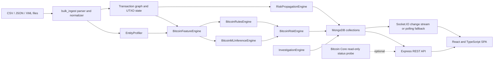

# V.E.C.T.O.R System Architecture

**Revision:** 10 October 2026, `update-branch` (repository revision recorded in Git). This describes the code in this repository. It does not certify that external services or serialized models work in a particular deployment.

## Product domains

V.E.C.T.O.R contains two related but distinct applications:

1. **Financial monitoring:** legacy Python producer/consumer scripts use Redis and MongoDB and are separate from the current Bitcoin REST workflow. The Mongo-backed financial dashboard also consumes seeded demo fixtures.
2. **Bitcoin transaction intelligence:** the Express server provides the browser API and Socket.IO. MongoDB persists records. Python modules normalize bulk data and implement entity profiling, graph and UTXO analysis, behavioral features, model inference, risk evaluation, risk propagation and investigations. The frontend is a React/TypeScript SPA.

The default Compose/demo configuration explicitly uses `BITCOIN_SIMULATION_MODE=true`. Seeded Bitcoin records are synthetic and carry `data_mode: SIMULATION`; a simulation status is not a connected Bitcoin Core node. The repository does not establish live block or mempool ingestion from Bitcoin Core.

## Bitcoin data path



Bulk file ingestion (`python -m bitcoin.bulk_ingest`) runs the Python analytics pipeline and persists output to MongoDB unless `--no-persist` is supplied. Destructive clearing is opt-in through `--drop-existing`. The Express `POST /api/bitcoin/ingest` invokes the Python single-transaction analysis module; `/ingest/raw` stores records explicitly marked `RAW_UNANALYZED` and does not score them. Manual investigation requests invoke `bitcoin.run_investigation`; the GET investigation endpoints retrieve stored dossiers.

### ML and risk semantics

The canonical feature list is `BITCOIN_FEATURE_KEYS` in `Backend/bitcoin/schemas.py` (66 features in this checkout). The feature engine creates named values from transaction, entity-history, UTXO and graph context. Inference validation arranges a dictionary in the canonical feature order, then applies the serialized scaler. If available and compatible, UMAP transforms the vector and HDBSCAN approximate prediction routes it to a cluster Isolation Forest. Cold-start and noise/unassigned cases use the XGBoost fallback. Isolation Forest decision values are inverted and normalized so the returned `ml_score` represents higher anomaly at higher values, bounded to `[0, 1]`. The score is an anomaly score, not a calibrated probability of illicit activity. The checked-in scikit-learn artifacts were serialized with version 1.7.1, so `requirements.txt` pins that version; the XGBoost pickle emits a compatibility warning when loaded with current XGBoost and should be migrated from its producing runtime before being treated as a stable production artifact.

If artifacts cannot load or inference fails, the ML engine returns `ML_UNAVAILABLE` and `ml_score: null`. Presence of model files is not proof that the runtime loaded them or that they are validated against ground truth. The risk engine combines available ML, graph, velocity, temporal, UTXO and rule signals, with configured default weights in `Backend/bitcoin/config.py`; missing ML is not an ML prediction. Final risk is a 0–100 composite; `get_risk_level` uses `<25 LOW`, `25–<50 MEDIUM`, `50–<75 HIGH`, and `>=75 CRITICAL`. Propagated risk is a separate graph-derived signal and may contribute to the composite where the ingestion path explicitly adds it.

The `is_illicit` source label is used as a seed label for graph propagation in the bulk pipeline; it is not an independent model input. Synthetic fixtures and seeded labels must not be treated as an unbiased evaluation set.

## Persistence and interfaces

MongoDB database defaults to `RedisTransactions` and uses `MONGO_URI` / `MONGO_DB_NAME`. Bitcoin collections used by the code include `bitcoin_blocks`, `bitcoin_transactions`, `bitcoin_entities`, `bitcoin_clusters`, `bitcoin_risk_events`, `bitcoin_investigations`, `bitcoin_ip_correlations`, `bitcoin_system_telemetry`, `bitcoin_utxos`, `bitcoin_addresses`, `bitcoin_graph_edges`, and `bitcoin_features`. Collection creation is usage-driven; an unused configured collection may not exist.

The Express API is implemented in `Frontend/server/index.js`. Domain routes include financial `/api/transactions` and `/api/transactions/stats`, plus Bitcoin `/api/bitcoin/*`. Routes return JSON; missing records generally return 404, invalid write payloads 400 (oversized batches 413), disabled writes 403, and server/runtime errors 500. Exact endpoint behavior should be read from the route implementation and `README.md` rather than inferred from old audit counts.

Socket.IO emits financial `newTransaction` and Bitcoin `bitcoin:newTransaction`, `bitcoin:newRiskEvent`, `bitcoin:newAlert`, `bitcoin:investigationCreated` events. When MongoDB supports change streams the server uses them; standalone MongoDB uses a polling fallback configured by `TXN_POLL_MS` (default 2000 ms). Polling is not an exactly-once delivery guarantee.

## Deployment architecture and operational boundaries

The public demonstration targets a decoupled cloud architecture:

```mermaid
flowchart TD
  User([Browser Client]) -->|HTTPS / Deep Links| Vercel[Vercel Frontend: React 18 + Vite 8 SPA]
  Vercel -.->|VITE_API_BASE_URL (build-time)| User
  User -->|REST API & Socket.IO| Render[Render Web Service: Unified Docker Container]
  subgraph Render Container [Render Container: Python 3.12 + Node 22]
    Express[Express REST API - port $PORT]
    Socket[Socket.IO Server]
    PythonSub[Python 3.12 Analytics & Scikit-learn Models]
    Healthz["Readiness Probe: GET /healthz"]
    Express --> PythonSub
    Express --> Socket
  end
  Render -->|TLS / Outbound IPs| Atlas[(MongoDB Atlas Free M0 / Dedicated)]
  subgraph Atlas Collections
    MongoFT[Financial Collections: Transactions]
    MongoBTC[Bitcoin Collections: Blocks, Txs, Entities, Clusters, Risk, Investigations]
  end
```

- **Frontend (Vercel):** Hosts the static React/Vite SPA. All deep links and client routes route to `index.html` via `Frontend/vercel.json`. The backend origin is configured via `VITE_API_BASE_URL` at build time. No Express, Python, or MongoDB secrets exist in Vercel.
- **Backend (Render):** A single Docker web service running `Dockerfile` (`python:3.12-slim` + Node 22). Serves Express, Socket.IO, and Python analytics. Binds to `0.0.0.0:$PORT`. Readiness is validated via `GET /healthz` (returns 503 until MongoDB connects, 200 `{status: 'ok', mode: 'simulation'}` when ready). Gracefully shuts down on `SIGTERM`/`SIGINT`.
- **Database (MongoDB Atlas):** Persistent cloud database for financial and Bitcoin collections. Initial synthetic datasets are seeded safely on first launch when `SEED_DEMO_DATA=true`. Startup does not drop existing collections. Network access is restricted to Render outbound IPs.
- **Security Boundaries:** Mutating API routes default to blocked (`DEMO_READ_ONLY=true`). Production write access requires an opt-in token (`API_WRITE_TOKEN`). In-process rate limiting, JSON payload limits (2 MB), batch limits (50 analyzed, 200 raw), and exact-origin CORS (`CORS_ORIGIN`) protect against resource abuse.
- **Simulation Scope:** Real Bitcoin Core RPC is only probed when `BITCOIN_SIMULATION_MODE=false`. The public demonstration explicitly runs in simulation mode with synthetic fixtures. Validated illicit-activity detection and live network monitoring are outside this demo scope.

## Legacy design material

Earlier architecture text in this repository described Redis Streams as the live Bitcoin transaction path, a Streamlit banking portal, automatic reclustering, a proprietary multi-signal system and production-ready operating characteristics. Those statements are design/history material and are not evidence that those workflows are wired into the current Express/Bitcoin UI. The older narrative remains in [TECHNICAL_WRITEUP.md](TECHNICAL_WRITEUP.md) only where called out as proposal/history; see [AUDIT/GO_NO_GO.md](AUDIT/GO_NO_GO.md) for current verification limits.
