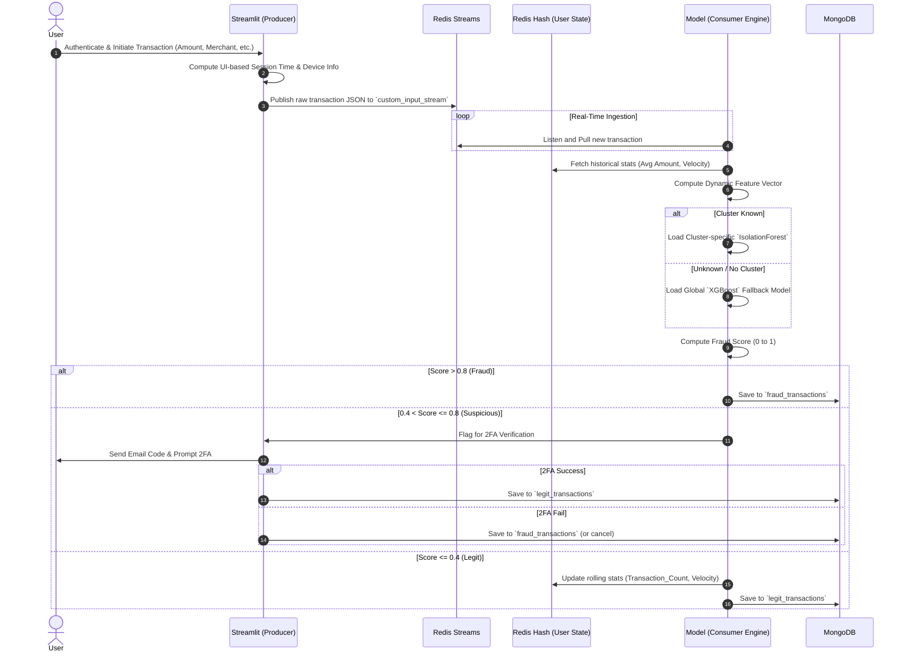
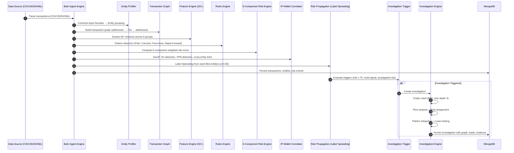

# V.E.C.T.O.R System Architecture

**V.E.C.T.O.R** (Velocity-Enhanced Clustering for Transactional Outlier Recognition) is a dual-domain real-time monitoring and intelligence system. The original financial transaction pipeline detects anomalies in banking operations using event-driven processing and per-cluster ML models. The extended **V.E.C.T.O.R-BITCOIN** pipeline provides AI-powered analysis of Bitcoin transaction traffic for law-enforcement investigation workflows.

---

## 🎯 Aim

To provide an accurate, real-time fraud detection and blockchain intelligence platform that dynamically profiles behavioral entities, micro-segments them into behavioral clusters, and leverages multi-layered anomaly detection to identify suspicious activity—without relying on static, rule-based systems.

## 🚀 Objectives

- **Real-Time Processing:** Ingest transactions through event-driven message brokers (Redis Streams) and process them with sub-second latency.
- **Dynamic Feature Extraction:** Compute 50+ rolling behavioral features (velocity, graph centrality, UTXO age, temporal burst patterns) from historical data.
- **Behavioral Micro-Segmentation:** Cluster entities via UMAP dimensionality reduction and HDBSCAN density-based clustering for per-group anomaly models.
- **Multi-Model Risk Scoring:** Fuse six independent signal components (ML anomaly, graph centrality, velocity, temporal, UTXO, heuristic rules) into a calibrated 0–100 risk score.
- **Automated Investigation Engine:** Automatically trigger graph-crawl investigations on high-risk entities, with follow-the-money flow analysis, role assignment, and ranked lead generation.
- **Risk Propagation:** Spread risk from known-illicit seed entities through the transaction graph using Label Spreading with exponential decay.
- **Explainability:** Generate signal-level decompositions and natural-language explanations for every risk assessment.
- **Persistent Storage & Auditing:** Segregate and store transactions, entities, risk events, and investigations in MongoDB for long-term analytics and dashboard reporting.

---

## 🛠️ Technologies Used

### Backend Engine & Machine Learning
- **Python 3.11+** — Core backend for data ingestion, ML pipelines, graph analytics, and investigation orchestration.
- **Redis & Redis Streams** — Real-time message queue for transaction events and in-memory key-value store for rolling user/entity state.
- **MongoDB 6.0+** — NoSQL persistence for transactions, entities, risk events, investigations, blocks, and IP correlations.
- **scikit-learn** — Anomaly detection (`IsolationForest`), scaling (`StandardScaler`, `MinMaxScaler`).
- **XGBoost** — Fallback gradient-boosted classifier for cold-start entities outside any cluster.
- **UMAP & HDBSCAN** — Dimensionality reduction and density-based clustering for behavioral micro-segmentation.
- **NetworkX** — Transaction graph construction, PageRank, betweenness centrality, and structural motif detection (with pure-Python fallback).
- **Pandas & NumPy** — Data wrangling, feature engineering, and aggregation (Trimmed K-Means).

### Frontend & API
- **React 18 + TypeScript 5** — Modern SPA for the intelligence dashboard.
- **Vite 5** — Fast development server and build tool.
- **TailwindCSS 3** — Utility-first CSS framework.
- **Chart.js + react-chartjs-2** — Data visualization (risk distributions, volume charts).
- **Framer Motion** — Micro-animations and transitions.
- **Lucide React** — Icon system.
- **Express.js 4** — REST API server with 12+ Bitcoin endpoint groups.
- **Socket.io 4** — Real-time WebSocket push for new transactions and risk events.

### Infrastructure
- **Linux (WSL Fedora 44)** — Fully offline deployment target.
- **Streamlit** — User-facing secure banking portal for the financial transaction domain.

---

## 🏗️ System Architecture Diagram

```
┌──────────────────────────────────────────────────────────────────────────┐
│                          V.E.C.T.O.R SYSTEM                             │
├──────────────────────────────────────────────────────────────────────────┤
│                                                                          │
│  ┌──────────────┐    ┌──────────────┐    ┌──────────────────────────┐   │
│  │ Data Sources  │    │  Ingestion   │    │    Feature Engine        │   │
│  │              │───►│  Engine      │───►│                          │   │
│  │ CSV/JSON/XML │    │ bulk_ingest  │    │ 50+ behavioral features  │   │
│  │ Bitcoin RPC  │    │ .py          │    │ across 9 groups          │   │
│  │ Redis Stream │    │              │    │                          │   │
│  └──────────────┘    └──────────────┘    └──────────┬───────────────┘   │
│                                                      │                   │
│  ┌──────────────┐    ┌──────────────┐    ┌──────────▼───────────────┐   │
│  │ Transaction  │    │  Entity      │    │    ML Pipeline           │   │
│  │ Graph        │◄──►│  Profiler    │    │                          │   │
│  │ (NetworkX)   │    │ Common-Input │    │ UMAP → HDBSCAN →        │   │
│  │              │    │ Heuristic    │    │ IsolationForest +        │   │
│  │ PageRank,    │    │              │    │ XGBoost Fallback         │   │
│  │ Betweenness  │    └──────────────┘    └──────────┬───────────────┘   │
│  └──────┬───────┘                                   │                   │
│         │            ┌──────────────┐    ┌──────────▼───────────────┐   │
│         │            │  IP-Wallet   │    │    Risk Engine            │   │
│         └───────────►│  Correlator  │───►│    6-Component Weighted   │   │
│                      │  GeoIP, Tor  │    │    Composite Scoring +   │   │
│                      │  Detection   │    │    Label Spreading        │   │
│                      └──────────────┘    └──────────┬───────────────┘   │
│                                                      │                   │
│  ┌──────────────┐    ┌──────────────────┐  ┌────────▼───────────────┐   │
│  │ MongoDB      │◄───│ Investigation    │◄─│    Alert Generator     │   │
│  │ Persistence  │    │ Engine           │  │    Ranked + Explained  │   │
│  └──────┬───────┘    │ Graph Crawl,     │  └────────────────────────┘   │
│         │            │ Flow Analysis,   │                               │
│         │            │ Lead Ranking     │                               │
│         │            └──────────────────┘                               │
│  ┌──────▼──────────────────────────────────────────────────────────┐    │
│  │               React + TypeScript Dashboard                       │    │
│  │  Overview ∙ Live Feed ∙ Transaction Explorer ∙ Entity Profiles  │    │
│  │  Risk Queue ∙ Graph Explorer ∙ Behavioral Clusters              │    │
│  │  Anomaly Timeline ∙ Investigation Manager ∙ Wallet Intelligence │    │
│  └──────────────────────────────────────────────────────────────────┘    │
└──────────────────────────────────────────────────────────────────────────┘
```

---

## 🏗️ Domain 1: Financial Transaction Monitoring

### Data Flow (Sequence Diagram)



### Core Components

1. **Trigger Engine (`trigger.py`)**
   - **Role:** Offline / batch processing.
   - **Mechanism:** Cleans historical CSVs using *Trimmed K-Means* to remove extreme outliers. It executes *UMAP* and *HDBSCAN* to form user clusters, then trains and exports an `IsolationForest` model for every cluster and an `XGBoost` global model. Saves the user-to-cluster mapping.

2. **Transaction Producer (`customproducer.py`)**
   - **Role:** Data injection.
   - **Mechanism:** A Streamlit UI simulating a real banking app. Handles login, session timing, and payload generation. Sends payloads immediately to `Redis Streams`. Includes a 2FA workflow relying on an SMTP server.

3. **Transaction Consumer Engine (`consumer.py`)**
   - **Role:** Real-time inference.
   - **Mechanism:** Subscribes to Redis Streams. Extracts dynamic features matching the model requirements, scales the vector, and infers the fraud probability. It writes outputs dynamically to MongoDB and maintains live user aggregation tables inside Redis Hashes.

---

## 🏗️ Domain 2: Bitcoin Transaction Intelligence

### Pipeline Data Flow



### Core Components

1. **Bulk Ingestion Engine (`bulk_ingest.py`)**
   - **Role:** Entry point for offline dataset processing.
   - **Mechanism:** Parses CSV/JSON/XML datasets conforming to the NTRO schema. Orchestrates the full pipeline: Parse → Graph → Features → Rules → Risk → IP Correlation → Risk Propagation → Investigation Trigger → Persist.

2. **Entity Profiler (`entity_profiler.py`)**
   - **Role:** Address-to-entity resolution.
   - **Mechanism:** Implements Common-Input-Ownership heuristic to group Bitcoin addresses into behavioral entities.

3. **Transaction Graph Engine (`transaction_graph.py`)**
   - **Role:** Graph construction and analytics.
   - **Mechanism:** Builds a directed graph (NetworkX or pure-Python fallback) of addresses → transactions → addresses. Computes PageRank, betweenness centrality, degree distribution, and detects structural motifs (peel chain, fan-in, fan-out, rapid forwarding).

4. **Feature Engine (`bitcoin_features.py`)**
   - **Role:** Feature extraction.
   - **Mechanism:** Computes 50+ behavioral features across 9 groups (Transaction Structural, Script Type, UTXO Lifecycle, Entity Behavioral, Graph Centrality, Motif/Pattern, Temporal, Value Distribution, Network/IP).

5. **Rules Engine (`bitcoin_rules.py`)**
   - **Role:** Heuristic pattern detection.
   - **Mechanism:** Detects peel chains, CoinJoin structures, fan-in/fan-out consolidation, rapid forwarding, dormant UTXO awakening, and Tor/VPN usage. Produces scored signals.

6. **Multi-Model Risk Engine (`risk_engine.py`)**
   - **Role:** Calibrated risk scoring with explainability.
   - **Mechanism:** Fuses 6 independent components with configurable weights:
     - ML Score (0.30) — Isolation Forest / XGBoost anomaly probability
     - Graph Score (0.20) — PageRank + degree centrality
     - Velocity Score (0.15) — Transaction rate deviation
     - Temporal Score (0.10) — Burst frequency + sudden activity
     - UTXO Score (0.10) — Dormant/young UTXO spending ratios
     - Rule Score (0.15) — Heuristic pattern matches

7. **IP-Wallet Correlator (`ip_correlator.py`)**
   - **Role:** Network-layer to blockchain-layer bridge.
   - **Mechanism:** Correlates relay IPs with wallet entities. Detects Tor exit nodes (prefix-based), VPN providers (ASN-based), computes geo-diversity, IP reuse counts, cross-entity IP links, burst scores, and composite anonymity scores.

8. **Risk Propagation Engine (`risk_propagation.py`)**
   - **Role:** Graph-based risk spreading.
   - **Mechanism:** Seeds known-illicit entities with risk = 1.0 and propagates through the transaction graph: `risk(v) = max(risk(v), α × max(risk(neighbors)))` where α = 0.65. Converges when max_change < 0.001 or after 10 iterations.

9. **Investigation Engine (`investigation_engine.py`)**
   - **Role:** Automated follow-the-money investigation.
   - **Mechanism:** Triggered when risk score ≥ 70, ≥ 3 multi-signal elevations, propagated risk ≥ 0.5, or ≥ 2 severe pattern combinations. Executes an 8-phase pipeline:
     1. Seed analysis
     2. Adaptive BFS graph crawl (max depth 3, max 100 entities)
     3. Flow analysis with value tracking
     4. Analytical role assignment (SOURCE, INTERMEDIARY, CONSOLIDATION, LAYERING, DISPERSAL, CONVERGENCE, EXIT_CANDIDATE)
     5. Pattern integration
     6. Risk propagation within investigation subgraph
     7. Lead ranking with priority classification (P1–P4)
     8. Evidence generation with natural-language explanations

10. **Synthetic Dataset Generator (`generate_dataset.py`)**
    - **Role:** Realistic test data production.
    - **Mechanism:** Generates transactions embedding 6 pattern archetypes: Normal (55%), Peel Chain (12%), CoinJoin (10%), Fan-in (8%), Fan-out (8%), Rapid Forwarding (7%). Includes GeoIP data, 3 entity archetypes, and Tor exit node simulation.

11. **ML Training Pipeline (`train.py`)**
    - **Role:** Model training.
    - **Mechanism:** StandardScaler → UMAP (n_components=8) → HDBSCAN → per-cluster Isolation Forest + global XGBoost fallback classifier.

---

## 🖥️ Frontend Dashboard

The React + TypeScript dashboard (`Frontend/`) provides 12 navigable views:

| Tab | Component | Description |
|-----|-----------|-------------|
| **Overview** | `BitcoinOverview.tsx` | System status, risk distribution, volume charts, pattern breakdown |
| **Live Feed** | `BitcoinLiveTransactions.tsx` | Real-time transaction stream via Socket.io |
| **Transaction Explorer** | `BitcoinTransactionExplorer.tsx` | Detailed transaction inspection with UTXO inputs/outputs |
| **Entity Profiles** | `BitcoinAddressEntityExplorer.tsx` | Entity browser with risk scores, cluster assignments, and address groupings |
| **Risk Queue** | `BitcoinRiskQueue.tsx` | Prioritized queue of flagged risk events for analyst triage |
| **Graph Explorer** | `BitcoinTransactionGraph.tsx` | Interactive transaction graph visualization |
| **Behavioral Clusters** | `BitcoinBehavioralClusters.tsx` | HDBSCAN cluster visualization with per-cluster anomaly rates |
| **Anomaly Timeline** | `BitcoinAnomalyTimeline.tsx` | Temporal view of anomalous activity |
| **Investigations** | `BitcoinInvestigations.tsx` | Investigation lifecycle manager (create, list, review) |
| **Investigation Detail** | `BitcoinInvestigationView.tsx` | Full investigation view with graph, flow path, leads, evidence, and role assignment |
| **Wallet Intelligence** | `WalletIntelligence.tsx` | Deep-dive wallet analysis with animated progress and entity-level intelligence reports |
| **Models / Sources / Settings** | Placeholder tabs | Reserved for model management, data source configuration, and system settings |

### API Server (`Frontend/server/index.js`)

Express.js REST API with 12 endpoint groups and Socket.io real-time push:

| # | Route Group | Endpoints |
|---|-------------|-----------|
| 1 | Status & Overview | `GET /api/bitcoin/status` |
| 2 | Blocks | `GET /api/bitcoin/blocks`, `GET /api/bitcoin/blocks/:height` |
| 3 | Transactions | `GET /api/bitcoin/transactions`, `GET /api/bitcoin/transactions/:txid` |
| 4 | Search | `GET /api/bitcoin/search` (multi-type: TX, entity, address, investigation) |
| 5 | Entities | `GET /api/bitcoin/entities`, `GET /api/bitcoin/entity/:entity_id` |
| 6 | Addresses | `GET /api/bitcoin/address/:address` |
| 7 | Wallet Analysis | `POST /api/bitcoin/wallets/:address/analyze` |
| 8 | Graph Explorer | `GET /api/bitcoin/graph/:node_id` |
| 9 | Risk Queue | `GET /api/bitcoin/risk-queue` |
| 10 | Clusters | `GET /api/bitcoin/clusters` |
| 11 | Investigations | `GET/POST /api/bitcoin/investigations`, `GET .../investigations/:id`, `GET .../investigations/:id/graph`, `GET .../investigations/:id/flow`, `GET .../investigations/:id/leads` |
| 12 | IP/Geo Analytics | `GET /api/bitcoin/geo-stats`, `GET /api/bitcoin/ip-correlations`, `GET /api/bitcoin/risk-propagation` |
| 13 | Bulk Ingestion | `POST /api/bitcoin/ingest` |

---

## ⚙️ Deployment

The system is fully offline and deploys on WSL Fedora with two scripts:

1. **`setup_fedora.sh`** — Installs MongoDB, Redis, Python 3.11+, Node.js 18+, creates virtual environment, installs all Python and Node dependencies.
2. **`run.sh`** — 7-step automated launcher:
   1. Activate Python venv
   2. Start MongoDB
   3. Start Redis
   4. Generate synthetic Bitcoin dataset (5,000 transactions)
   5. Run bulk ingestion pipeline (full AI/ML processing)
   6. Train ML models (if not already trained)
   7. Start Express.js backend (port 3001) + Vite frontend (port 5173)

Access at `http://localhost:5173` after running `./run.sh`.

---

## 📁 Project Structure

```
V.E.C.T.O.R/
├── Backend/
│   ├── bitcoin/                    # Bitcoin intelligence pipeline
│   │   ├── bulk_ingest.py          # Full pipeline orchestrator (CSV/JSON/XML → MongoDB)
│   │   ├── investigation_engine.py # Automated investigation + graph crawl + lead ranking
│   │   ├── risk_engine.py          # 6-component multi-model risk scoring
│   │   ├── risk_propagation.py     # Label Spreading with exponential decay
│   │   ├── transaction_graph.py    # NetworkX graph + PageRank + motif detection
│   │   ├── bitcoin_features.py     # 50+ feature extraction engine
│   │   ├── bitcoin_rules.py        # Heuristic pattern detection
│   │   ├── entity_profiler.py      # Common-input entity resolution
│   │   ├── ip_correlator.py        # IP-wallet correlation + Tor/VPN detection
│   │   ├── utxo_manager.py         # UTXO lifecycle tracking
│   │   ├── generate_dataset.py     # Synthetic dataset generator
│   │   ├── train.py                # ML model training pipeline
│   │   ├── config.py               # Centralized configuration
│   │   ├── schemas.py              # Feature keys and risk level helpers
│   │   ├── rpc_client.py           # Bitcoin Core RPC client
│   │   ├── block_processor.py      # Block-level processing
│   │   └── models/                 # Trained model artifacts
│   ├── consumer.py                 # Financial: real-time inference consumer
│   ├── customproducer.py           # Financial: Streamlit banking portal
│   ├── trigger.py                  # Financial: batch training (UMAP + HDBSCAN + IsolationForest)
│   └── common_constants.py         # Shared constants
├── Frontend/
│   ├── server/
│   │   ├── index.js                # Express.js API + Socket.io (12+ endpoint groups)
│   │   ├── seed.js                 # Financial DB seeder
│   │   └── seed_bitcoin.js         # Bitcoin DB seeder
│   └── src/
│       ├── App.tsx                 # Router with 15+ routes
│       ├── pages/
│       │   ├── Dashboard.tsx       # Financial monitoring dashboard
│       │   └── bitcoin/            # 12 Bitcoin intelligence views
│       ├── components/             # Shared UI components (9 components)
│       ├── context/                # React context (Transaction, Bitcoin, Theme)
│       └── types/                  # TypeScript type definitions
├── AUDIT/                          # System audit reports and test results
├── run.sh                          # One-command deployment launcher
├── setup_fedora.sh                 # Dependency installer for WSL Fedora
└── requirements.txt                # Python dependencies
```
