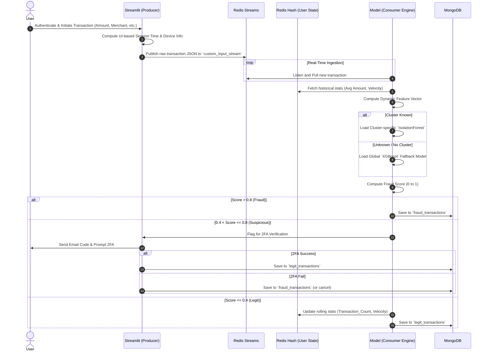

# V.E.C.T.O.R System Architecture

**V.E.C.T.O.R** (Velocity-Enhanced Clustering for Transactional Outlier Recognition) is a real-time banking and transaction monitoring system. The core architecture uses event-driven processing and machine learning to cluster users based on historical behaviors and detect anomalies in real-time.

---

## 🎯 Aim

To provide an accurate, real-time fraud detection banking system that dynamically profiles user behavior, micro-segments users into behavioral clusters, and leverages multi-layered anomaly detection to identify suspicious transactions without relying strictly on static, rule-based systems.

## 🚀 Objectives

- **Real-Time Processing:** Ingest incoming transactions through a user-facing banking portal and instantly process them using an event-driven message broker.
- **Dynamic Feature Extraction:** Compute and maintain rolling transaction features (like `Velocity`, `Avg_Amount`, `Transactions_Per_Day`, and `Large_Transaction_Frequency`) based on historical behavior rather than static rules.
- **Behavioral Micro-segmentation:** Group users based on robust behavioral profiles (using UMAP and HDBSCAN) so anomaly models can learn specialized patterns for different types of users.
- **Multi-layered Anomaly Detection:** Classify transactions in real-time using cluster-specific Isolation Forest models, with a global XGBoost fallback model for unclustered/new users.
- **Secure Verification (2FA):** Buffer suspicious transactions and demand immediate email-based two-factor authentication to curb false positives.
- **Persistent Storage & Auditing:** Segregate and store "Legit" and "Fraud" transactions securely for long-term analytics and dashboard reporting.

---

## 🛠️ Technologies Used

### Backend Engine & Machine Learning
- **Python:** Core backend language for data streaming, ML pipelines, and modeling.
- **Redis & Redis Streams:** Used as a message queue (Pub/Sub) for real-time transaction events and as a fast, in-memory key-value store to maintain real-time user hashes (Velocity, transaction counts, etc.).
- **MongoDB:** NoSQL database used for persistent logging of transactions (separated into `legit_transactions` and `fraud_transactions` collections).
- **Scikit-Learn:** Used for anomaly detection (`IsolationForest`) and scaling (`MinMaxScaler`, `StandardScaler`).
- **XGBoost:** Used as the fallback classifier for predicting anomalies on users with insufficient historical data.
- **UMAP & HDBSCAN:** Used for dimensionality reduction and density-based clustering to map users into micro-segments.
- **Pandas & NumPy:** For data wrangling, feature engineering, and robust aggregation (e.g., Trimmed K-Means).

### Frontend Interfaces
- **Streamlit (`customproducer.py`):** Serves as the user-facing secure banking portal allowing users to securely authenticate and initiate new transactions.
- **React, Vite, & Tailwind (in `Frontend/`):** A modern JavaScript stack for a transaction monitoring admin dashboard, utilizing **Express** and **Socket.io** for real-time metric visualization.

---

## 🏗️ Low Level Architecture & Data Flow

Below is the sequence diagram illustrating how transactions move through the V.E.C.T.O.R pipeline:

## ⚙️ Core Components Overview

1. **Trigger Engine (`trigger.py`)**
   - **Role:** Offline / batch processing.
   - **Mechanism:** Cleans historical CSVs using *Trimmed K-Means* to remove extreme outliers. It executes *UMAP* and *HDBSCAN* to form user clusters, then trains and exports an `IsolationForest` model for every cluster and an `XGBoost` global model. Saves the user-to-cluster mapping.
   
2. **Transaction Producer (`customproducer.py`)**
   - **Role:** Data injection.
   - **Mechanism:** A Streamlit UI simulating a real banking app. Handles login, session timing, and payload generation. Sends payloads immediately to `Redis Streams`. Includes a 2FA workflow relying on an SMTP server.

3. **Transaction Consumer Engine (`consumer.py`)**
   - **Role:** Real-time inference.
   - **Mechanism:** Subscribes to Redis Streams. Extracts dynamic features matching the model requirements, scales the vector, and infers the fraud probability. It writes outputs dynamically to MongoDB and maintains live user aggregation tables inside Redis Hashes.
